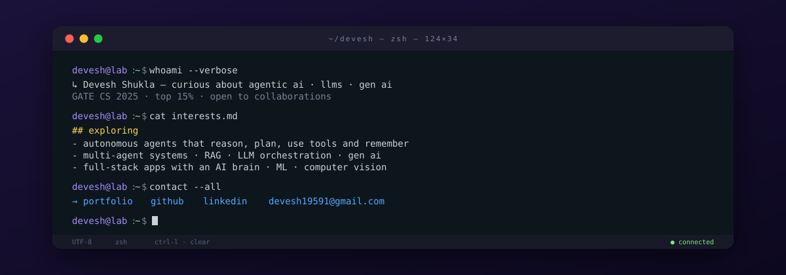

  

  
  
  

  

### ◈ What pulls me in

I'm fascinated by AI moving from **prompt → response** to **goal → plan → act → reflect**: systems that reason, call tools, remember context and work together as teams of agents. That's where I spend my time learning and building.

| Area of interest | What I explore |
| :-- | :-- |
| 🧠 **Agentic AI** | Autonomous agents, planning & reflection loops, multi-agent collaboration |
| 🔗 **LLMs** | RAG, embeddings, vector search, tool calling, agent memory |
| ⚡ **Generative AI** | LLM-powered apps, prompt & context design, AI workflows |
| 🔬 **Machine Learning** | Deep learning, NLP, computer vision |
| 💻 **Software Development** | Backend APIs, system design, full-stack web apps |

### ◈ Selected work

<b>📄 Social Hub — AI Resume Screening</b>

 

Uses NLP and machine learning to parse resumes and rank them against a job description.
`Python` · `NLP` · `scikit-learn`

<b>🧪 AI & ML experiments</b>

 

Hands-on deep learning, NLP and computer-vision experiments.
`PyTorch` · `TensorFlow` · `OpenCV`

<b>🤖 Agentic AI lab — in progress</b>

 

A multi-agent research assistant with tool use, retrieval and persistent memory.
`LangGraph` · `LangChain` · `FastAPI`

  

  

### ◈ Milestones

| | |
| :-- | :-- |
| 🎯 **GATE CS 2025** | Score 435 · top 15% |
| 🥉 **Hack The Space 2023** | Bronze award · 3rd prize |
| ☁️ **AWS** | Generative AI Solutions |
| ☁️ **Oracle Cloud** | AI Foundations Associate |
| ☁️ **Microsoft Azure** | Azure Fundamentals |

### ◈ Activity

<picture>
  <source media="(prefers-color-scheme: dark)" srcset="https://raw.githubusercontent.com/Deveshshukla36/Deveshshukla36/output/snake-dark.svg" />
  <source media="(prefers-color-scheme: light)" srcset="https://raw.githubusercontent.com/Deveshshukla36/Deveshshukla36/output/snake.svg" />
  
</picture>

  Think beyond prompts. Build autonomous intelligence.

